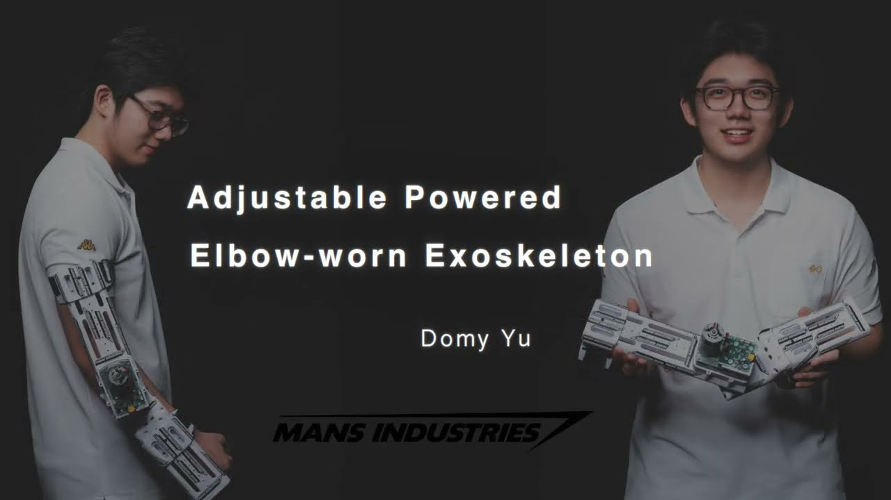
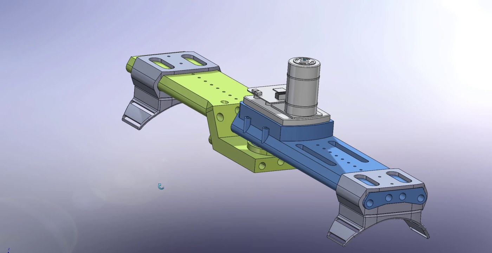
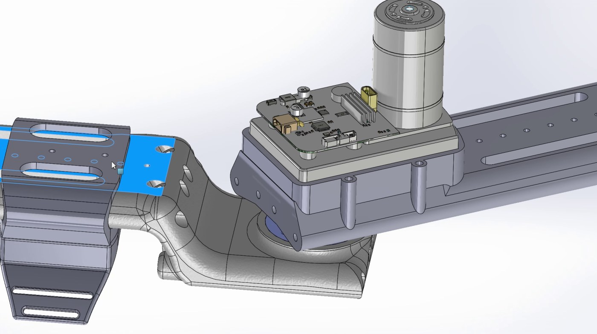
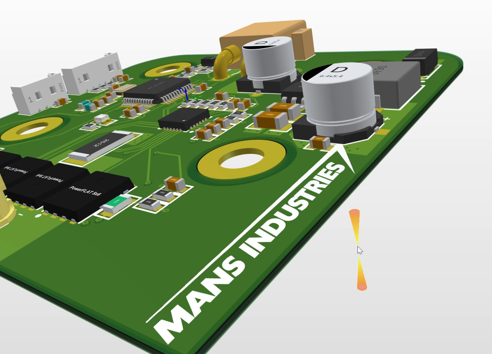
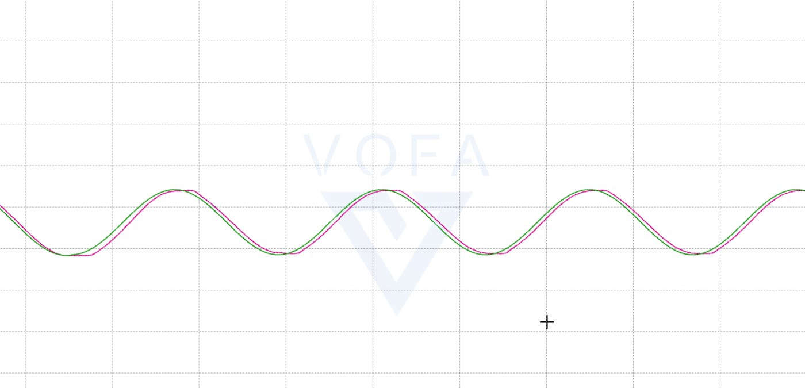

<p align="center">
  <picture>
    <source media="(prefers-color-scheme: dark)" srcset="docs/images/mans-logo-white.png" />
    
  </picture>
</p>

# MANS: Adjustable Powered Elbow-Worn Exoskeleton

**English** | [简体中文](README.zh-CN.md)

The first hardware prototype of MANS: a wearable elbow joint with its own motor driver board, a 3D-printed structure, and STM32 firmware that drives the joint along a smooth motion curve.

[](https://www.youtube.com/watch?v=gO6-Dt_JAZw)

▶ [Watch the prototype video on YouTube](https://www.youtube.com/watch?v=gO6-Dt_JAZw)

## System

```text
Target curve (100 Hz)
        |
        v
  Position PID --> Speed PID --> DRV8701 + H-bridge --> Motor and elbow joint
        ^                                                        |
        |                                                        |
        +----------------- AS5047P joint angle <-----------------+
```

## Mechanical design



Upper-arm and forearm links meet at a motor-driven joint, with the control board mounted on the joint housing. Cuffs hold the links to the arm, and slotted sliding parts adjust the fit. The parts were modeled in SolidWorks and 3D printed.



## Electronics



The board is a four-sheet Altium Designer project:

| Sheet | Function | Key parts |
|---|---|---|
| [Power](docs/images/schematic-power.jpg) | 24 V input to 3.3 V buck supply | TPS5430, XT30 input |
| [MCU](docs/images/schematic-mcu.jpg) | Controller, 16 MHz crystal, SWD and UART headers | STM32F103C8T6 |
| [Driver](docs/images/schematic-driver.jpg) | Brushed motor H-bridge with a 5 mΩ current shunt | DRV8701, four HYG015N04 MOSFETs |
| [Sensing](docs/images/schematic-sensing.jpg) | Joint angle, temperature and input voltage sensing | AS5047P, 10 kΩ NTC thermistors |

## Firmware

The firmware is an STM32CubeMX and Keil MDK project for the STM32F103C8 at 72 MHz. TIM2 runs the control loop at 100 Hz:

1. Update the target angle: `45 - 44 cos(2π · 0.1 · t)` degrees, offset by the angle measured at startup.
2. Read the joint angle and estimate its speed from the AS5047P.
3. Run the position PID to get a target speed, limited to ±300°/s.
4. Run the speed PID to get a PWM duty, and set the motor direction and duty through the DRV8701.
5. Stream the angle, target and speeds over UART at 115200 baud for tuning in VOFA+.



The tuning code is in [`main.c`](firmware/elbowEXO/Core/Src/main.c). The encoder, motor driver and PID modules are in [`MDK-ARM`](firmware/elbowEXO/MDK-ARM).

## Repository layout

```text
firmware/elbowEXO/    STM32CubeMX and Keil MDK project
hardware/pcb/         Altium Designer schematics and PCB
hardware/mechanical/  SolidWorks parts and assemblies, STEP files, 3MF print files
docs/images/          Images used in this README
```

The 108 MB STEP export of the PCB is left out because it exceeds GitHub's file size limit. `hardware/mechanical/pcb1.SLDPRT` holds the board model for the assembly.

## Current status

This is an early prototype. It runs a fixed demonstration curve and does not yet read the wearer's intent.

- **Fault handling:** a driver fault stops the motor for one cycle, but the next control cycle can restart it. The fault is not latched.
- **Motor direction:** direction follows the sign of the target speed rather than the sign of the speed PID output.
- **Control loop timing:** the loop prints over UART inside the timer interrupt, which blocks while each message is sent.

> **Safety:** this is an experimental prototype and not a medical device. It can apply force to the arm. Do not use it on a person without your own safety review, mechanical limits and an emergency stop.

## License

Copyright © 2025 Domy Yu. All rights reserved for the MANS designs, firmware application code, and logo. No open-source license is granted at this time.

The STM32 HAL and CMSIS files under `firmware/elbowEXO/Drivers` stay under their original licenses, which are included in that folder.
