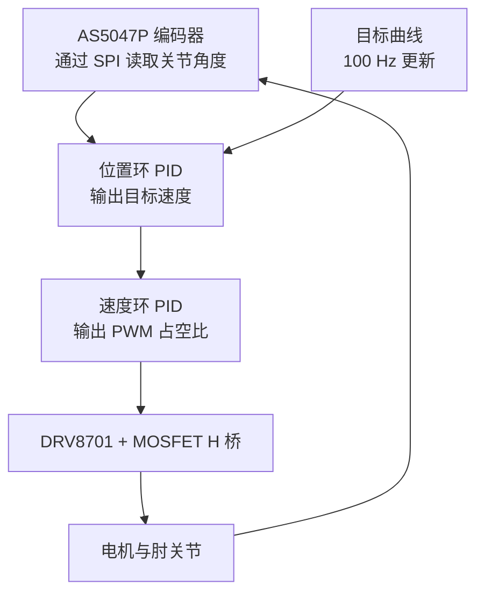
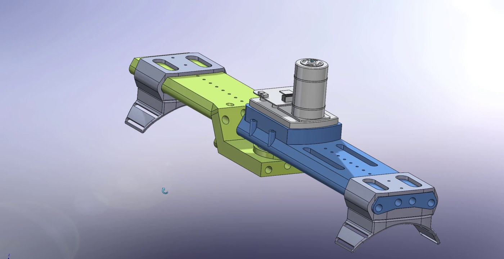
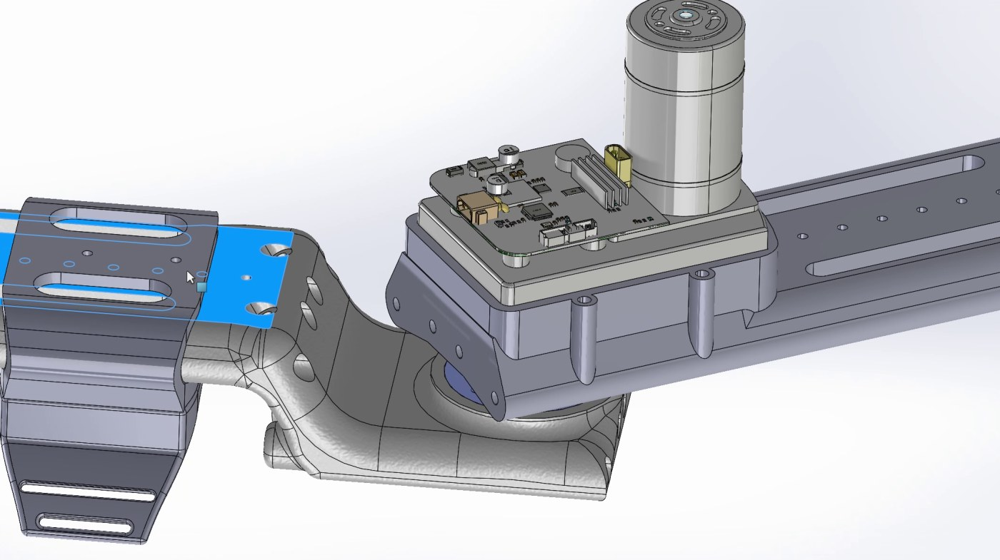
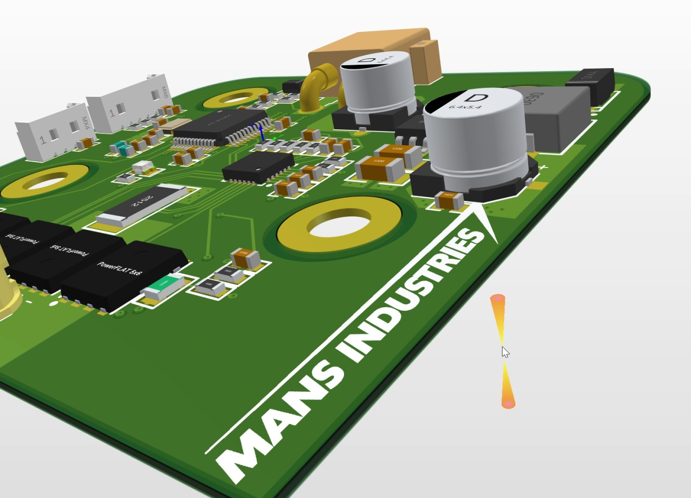
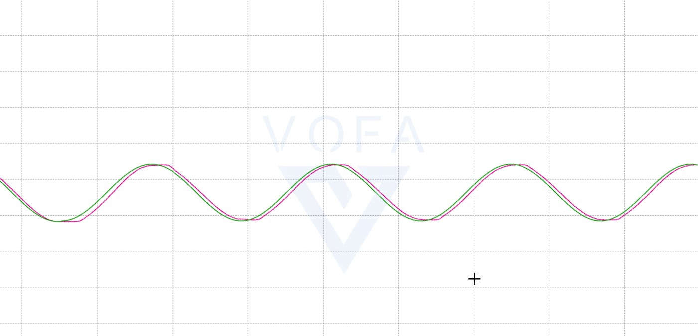

<p align="center">
  <picture>
    <source media="(prefers-color-scheme: dark)" srcset="docs/images/logo-light.png" />
    
  </picture>
</p>

# MANS：可调节肘部助力外骨骼

[English](README.md) | **简体中文**

这是 MANS 的第一代硬件原型：一个可穿戴的肘关节，包含自制电机驱动板、3D 打印结构，以及让关节沿平滑曲线运动的 STM32 固件。

[](https://www.youtube.com/watch?v=gO6-Dt_JAZw)

▶ [在 YouTube 观看原型视频](https://www.youtube.com/watch?v=gO6-Dt_JAZw)

## 系统结构



## 机械设计



大臂和小臂连杆在电机驱动的关节处相连，控制板安装在关节外壳上。绑缚件把连杆固定在手臂上，带长槽的滑动件用来调节佩戴尺寸。零件用 SolidWorks 建模并 3D 打印。



## 电路设计



电路板是一个包含四张原理图的 Altium Designer 工程：

| 原理图 | 功能 | 主要器件 |
|---|---|---|
| [电源](docs/images/schematic-power.jpg) | 24 V 输入，降压到 3.3 V | TPS5430、XT30 输入 |
| [主控](docs/images/schematic-mcu.jpg) | 控制器、16 MHz 晶振、SWD 和串口接口 | STM32F103C8T6 |
| [驱动](docs/images/schematic-driver.jpg) | 有刷电机 H 桥，带 5 mΩ 电流采样电阻 | DRV8701、四颗 HYG015N04 MOSFET |
| [传感](docs/images/schematic-sensing.jpg) | 关节角度、温度和输入电压采样 | AS5047P、10 kΩ NTC 热敏电阻 |

## 固件

固件是基于 STM32CubeMX 和 Keil MDK 的工程，运行在 72 MHz 的 STM32F103C8 上。TIM2 以 100 Hz 运行控制循环：

1. 更新目标角度：`45 - 44 cos(2π · 0.1 · t)` 度，并加上启动时测得的角度作为偏移。
2. 从 AS5047P 读取关节角度并估算速度。
3. 运行位置环 PID 得到目标速度，限制在 ±300°/s。
4. 运行速度环 PID 得到 PWM 占空比，通过 DRV8701 设置电机方向和占空比。
5. 通过 115200 波特率的串口输出角度、目标值和速度，用于在 VOFA+ 中调参。



调参代码在 [`main.c`](firmware/elbowEXO/Core/Src/main.c)，编码器、电机驱动和 PID 模块在 [`MDK-ARM`](firmware/elbowEXO/MDK-ARM)。

## 仓库结构

```text
firmware/elbowEXO/    STM32CubeMX 和 Keil MDK 工程
hardware/pcb/         Altium Designer 原理图和 PCB
hardware/mechanical/  SolidWorks 零件和装配体、STEP 文件、3MF 打印文件
docs/images/          本文档使用的图片
```

PCB 导出的 108 MB STEP 文件超过 GitHub 的单文件大小限制，因此没有上传。装配体使用的电路板模型是 `hardware/mechanical/pcb1.SLDPRT`。

## 当前状态

这是一个早期原型。它运行固定的演示曲线，还不能识别穿戴者的运动意图。

- **故障处理：** 驱动器故障时电机只停一个周期，下一个控制周期可能重新启动。故障状态没有锁存。
- **电机方向：** 方向由目标速度的正负决定，而不是速度环 PID 输出的正负。
- **控制循环耗时：** 控制循环在定时器中断里通过串口打印，发送每条消息时都会阻塞。

> **安全提示：** 这是实验性原型，不是医疗器械，并且可能对手臂施加作用力。如果没有做好安全评估、机械限位和急停，请勿在人身上使用。

## 许可

Copyright © 2025 Domy Yu。MANS 的设计、固件应用代码和 logo 保留所有权利，目前不授予开源许可。

`firmware/elbowEXO/Drivers` 下的 STM32 HAL 和 CMSIS 文件仍遵循其原有许可，许可文件已包含在该目录中。
